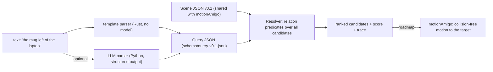

# spatialAmigo

**Resolve spatial referring expressions like "the mug left of the laptop" in 3D scenes, deterministically, fast and with a trace that explains every decision.**

> Status: work in progress. This README is a skeleton and grows with each milestone.

## Pitch

A language model may translate language into a query. The decision itself is made by deterministic geometry that is fast, testable and auditable.

## Scene format v0.1

Shared with the sister project motionAmigo. See [`schema/scene-v0.1.json`](schema/scene-v0.1.json) and the example [`examples/scenes/tabletop.json`](examples/scenes/tabletop.json).

## Quickstart

### Rust

```rust
use spatialamigo::{Resolver, Scene};

let scene = Scene::from_json(&std::fs::read_to_string("examples/scenes/tabletop.json")?)?;
let resolver = Resolver::new(scene);
let res = resolver.resolve_text("the mug left of the laptop")?;
assert_eq!(res.best.as_deref(), Some("mug_2"));
println!("{}", res.explanation);
```

```text
query: mug | left(laptop)
selected mug_2 with score 0.764 (margin 0.764 over rank 2, 2 candidate(s))
  #1 mug_2 score 0.764: left(laptop_1)[allocentric] = 0.764 (sector 0.825, distance_falloff 0.926)
  #2 mug_1 score 0.000: left(laptop_1)[allocentric] = 0.000 (sector 0.000, distance_falloff 0.903)
```

Try it: `cargo run -p spatialamigo --example resolve -- examples/scenes/tabletop.json "the mug closest to the bowl"`.

## Architecture



## Relations

Coming with milestone M1, see `docs/relations.md`.

## Benchmarks

### Synthetic Sr3D-style benchmark

6000 generated indoor scenes (seed 42, 400 per relation), each with the referred object and 1 to 3 distractors of the same class, ground truth from a crisp re-implementation of the Sr3D rules. Details and per-relation numbers in [`docs/benchmark.md`](docs/benchmark.md).

| Family | Text to target | Nearest-anchor baseline | Random | Noise σ=5 cm/5° | Noise σ=10 cm/10° | Held-out paraphrases |
| --- | ---: | ---: | ---: | ---: | ---: | ---: |
| horizontal proximity | 100.0 | 50.0 | 36.5 | 99.4 | 96.4 | 100.0 |
| between | 100.0 | 79.8 | 35.7 | 100.0 | 99.5 | 100.0 |
| vertical proximity | 100.0 | 99.8 | 39.5 | 100.0 | 99.2 | 86.1 |
| support | 100.0 | 100.0 | 40.1 | 98.6 | 93.4 | 75.1 |
| allocentric | 100.0 | 39.5 | 38.7 | 99.8 | 99.2 | 82.3 |
| egocentric | 100.0 | 37.7 | 38.1 | 100.0 | 99.9 | 84.4 |
| **all** | **100.0** | 59.2 | 38.3 | 99.7 | 98.3 | 86.0 |

Top-1 accuracy in %. Clean scenes are a consistency check (the scenes are unambiguous by construction, so the soft scores must agree with the crisp rules). The informative columns are the baseline (directional relations are where relational reasoning matters), pose noise (robustness to perception errors) and held-out paraphrases (limits of the template parser, the motivation for the optional LLM parser).

## Limitations

To be written.

## Roadmap

To be written.

## License

Licensed under either of [Apache License, Version 2.0](LICENSE-APACHE) or [MIT license](LICENSE-MIT) at your option.
