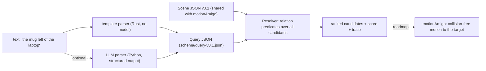

# spatialAmigo

**Resolve spatial referring expressions like "the mug left of the laptop" in 3D scenes, deterministically, fast and with a trace that explains every decision.**

> Status: work in progress. This README is a skeleton and grows with each milestone.

## Pitch

A language model may translate language into a query. The decision itself is made by deterministic geometry that is fast, testable and auditable.

## Scene format v0.1

Shared with the sister project motionAmigo. See [`schema/scene-v0.1.json`](schema/scene-v0.1.json) and the example [`examples/scenes/tabletop.json`](examples/scenes/tabletop.json).

## Quickstart

### Rust

```rust
use spatialamigo::{Resolver, Scene};

let scene = Scene::from_json(&std::fs::read_to_string("examples/scenes/tabletop.json")?)?;
let resolver = Resolver::new(scene);
let res = resolver.resolve_text("the mug left of the laptop")?;
assert_eq!(res.best.as_deref(), Some("mug_2"));
println!("{}", res.explanation);
```

```text
query: mug | left(laptop)
selected mug_2 with score 0.764 (margin 0.764 over rank 2, 2 candidate(s))
  #1 mug_2 score 0.764: left(laptop_1)[allocentric] = 0.764 (sector 0.825, distance_falloff 0.926)
  #2 mug_1 score 0.000: left(laptop_1)[allocentric] = 0.000 (sector 0.000, distance_falloff 0.903)
```

Try it: `cargo run -p spatialamigo --example resolve -- examples/scenes/tabletop.json "the mug closest to the bowl"`.

## Architecture



## Relations

Coming with milestone M1, see `docs/relations.md`.

## Benchmarks

Coming with milestones M3 and M6.

## Limitations

To be written.

## Roadmap

To be written.

## License

Licensed under either of [Apache License, Version 2.0](LICENSE-APACHE) or [MIT license](LICENSE-MIT) at your option.
