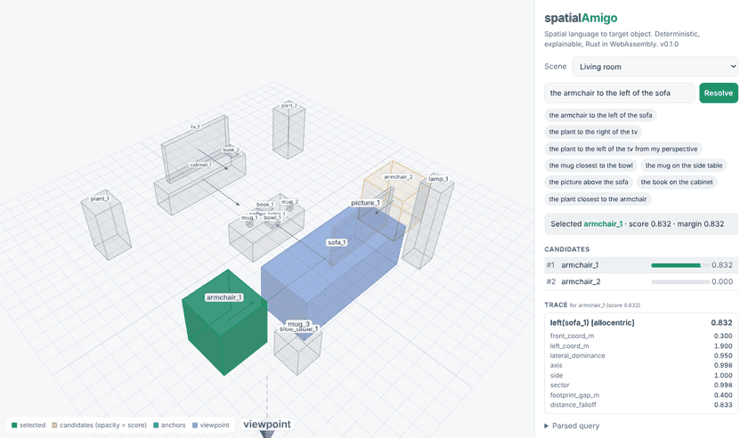
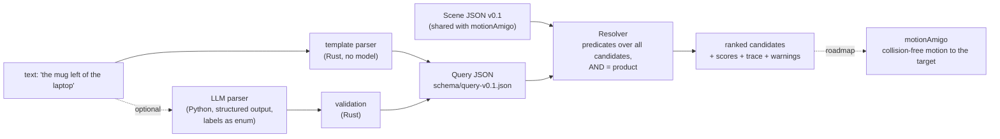

# spatialAmigo

[](https://github.com/Amerigo2020/spatialAmigo/actions/workflows/ci.yml)


**spatialAmigo resolves spatial referring expressions such as "the mug left of the laptop" in 3D scenes, deterministically, in microseconds, and explains every decision with a trace of the geometric predicates behind it.**



**[Live demo](https://amerigo2020.github.io/spatialAmigo/)** · Rust core, Python bindings (PyO3), WebAssembly demo (three.js). Relation families follow Sr3D from ReferIt3D (ECCV 2020), extended by an egocentric frame for robots with a camera.

## Why

A robot that is told "pick the mug left of the laptop" has to turn language into one object id before any motion planning can start. Learned 3D grounding models do this end to end, but their decisions are hard to audit and hard to fix when they are wrong.

spatialAmigo follows the design principle of [TRACE](#citation) (hybrid retrieval and deterministic tool orchestration for auditable AI compliance systems): **a language model may translate language into a structured query, the decision itself is deterministic, fast and explained.**

* **Deterministic and auditable.** Every candidate gets a score in `[0, 1]` and a trace with the intermediate quantities (footprint gap, vertical clearance, sector membership, ...). The explanation warns when the best match is weak or the expression is ambiguous, so a robot can ask back instead of guessing.
* **Exact geometry on oriented boxes.** Footprints with yaw, exact convex intersections and distances, allocentric frames from the object's own front, egocentric frames from the camera.
* **Language in two ways.** A rule-based template parser in Rust (no model, runs in the browser) and an optional LLM parser in Python that fills the same query schema via structured output, with the scene's labels as an enum so it cannot invent objects.
* **Tested like a library.** Unit tests, property tests (translation and rotation invariance, mirroring swaps left and right), a seeded synthetic benchmark with an independent Sr3D-style oracle, pose-noise robustness, held-out paraphrases, and a NumPy reference implementation that agrees with the Rust scores to within 1e-12.

## Quickstart

### Python

Development uses [uv](https://docs.astral.sh/uv/) and [maturin](https://www.maturin.rs/) (needs a Rust toolchain):

```bash
git clone https://github.com/Amerigo2020/spatialAmigo && cd spatialAmigo
uv sync                    # creates .venv, builds the Rust extension
uv run maturin develop     # rebuild after changing Rust code (add --release for benchmarks)
uv run pytest              # 46 tests, no network, no API key
```

```python
import spatialamigo as sa

resolver = sa.Resolver(sa.Scene.from_file("examples/scenes/tabletop.json"))

res = resolver.resolve("the mug to the left of the chair from my perspective")
res.best, res.margin               # ('mug_2', 0.38)
res.candidates[0]["trace"]          # relation, family, frame, anchors, score, features
print(res.explanation)

# structured query, e.g. from a task planner or an LLM
resolver.resolve({"target": "mug", "constraints": [{"relation": "closest", "anchors": ["bowl"]}]}).best  # 'mug_1'
```

### Rust

```rust
use spatialamigo::{Resolver, Scene};

let scene = Scene::from_json(&std::fs::read_to_string("examples/scenes/tabletop.json")?)?;
let resolver = Resolver::new(scene);
let res = resolver.resolve_text("the mug left of the laptop")?;
assert_eq!(res.best.as_deref(), Some("mug_2"));
println!("{}", res.explanation);
```

```text
query: mug | left(laptop)
selected mug_2 with score 0.913 (margin 0.911 over rank 2, 2 candidate(s))
  #1 mug_2 score 0.913: left(laptop_1)[allocentric] = 0.913 (sector 0.949, distance_falloff 0.962)
  #2 mug_1 score 0.002: left(laptop_1)[allocentric] = 0.002 (sector 0.002, distance_falloff 0.949)
```

The same scene shows why frames matter. The chair faces the table, so *its* left is on the other side than the observer's left:

```text
> the mug to the left of the chair                          (allocentric: the chair's own left)
selected mug_1 with score 0.002 ...
warning: the best score 0.002 is below 0.5, the relation barely holds for any candidate
> the mug to the left of the chair from my perspective      (egocentric: the viewpoint's left)
selected mug_2 with score 0.379 ...
```

Both mugs are really in front of the chair, and the trace says so instead of pretending to be sure. More: `cargo run -p spatialamigo --example resolve -- examples/scenes/living_room.json "the plant to the right of the tv"` and `cargo run -p spatialamigo --example structured_query`.

### Web demo

Live at https://amerigo2020.github.io/spatialAmigo/. To build it locally:

```bash
scripts/build_web.sh                           # wasm-pack + three.js into web/dist
python3 -m http.server -d web/dist 8000        # open http://localhost:8000
```

Pick a scene, type an expression or a JSON query, and inspect the ranked candidates and the per-predicate trace. Everything runs client side in WebAssembly. `scripts/capture_demo.py` regenerates the GIF headless with Playwright.

### Optional LLM parser

The template parser covers Sr3D-style sentences. For free language, `spatialamigo.llm` asks a model to fill the query schema with structured output, then hands the query to the deterministic resolver:

```python
from spatialamigo.llm import LLMParser, Anthropic, OpenAICompatible

parser = LLMParser(Anthropic(model="<claude model id>"))                     # ANTHROPIC_API_KEY
# parser = LLMParser(OpenAICompatible(model="<model id>"))                   # OPENAI_API_KEY
# parser = LLMParser(OpenAICompatible(model="llama3.1", base_url="http://localhost:11434/v1"))  # Ollama, vLLM, ...
res = parser.resolve(resolver, "grab the cup that sits left of my laptop")   # -> mug_2
```

* OpenAI-compatible APIs use `response_format` with a strict JSON schema; Anthropic uses a forced tool call whose `input_schema` is the query schema.
* The schema restricts `target` and `anchors` to the labels present in the scene, the Rust core validates the result, and one retry carries the validation error back to the model.
* No SDK dependency and no key needed for tests: providers take a `transport` callable. `python/tests/test_llm.py` runs on mocks and fixtures in the providers' response formats; `scripts/record_llm_fixtures.py` re-records them against live APIs.

## Architecture



| Path | Content |
| --- | --- |
| `crates/spatialamigo` | core: scene format, geometry, relations, query model, template parser, resolver with trace. Only `serde`, `serde_json`, `thiserror`; `#![forbid(unsafe_code)]` |
| `crates/spatialamigo-py` | PyO3 bindings (`spatialamigo._core`, abi3 wheel for Python 3.9+) |
| `crates/spatialamigo-wasm` | wasm-bindgen bindings used by the web demo |
| `crates/spatialamigo-eval` | seeded synthetic benchmark with a crisp Sr3D-style oracle |
| `python/spatialamigo` | Python package: bindings, `llm` (LLM parser), `sr3d` (ReferIt3D adapter) |
| `web/` | static three.js demo, no bundler |
| `eval/sr3d/` | Sr3D on ScanNet: runner and step-by-step data instructions |
| `bench/` | NumPy reference implementation and benchmark table scripts |
| `docs/` | [relation definitions](docs/relations.md), [benchmark](docs/benchmark.md), [design decisions](docs/decisions.md) |

## Scene format v0.1

JSON, meters, z up, right-handed. `center` is the box center, `size` the full edge lengths in the object frame, `yaw` the rotation about z in radians, `front` an optional unit vector in the object frame, `viewpoint` an optional observer pose. The format is shared with the sister project **motionAmigo** (motion planning for robot arms in Rust) and only changes with a version bump. Schema: [`schema/scene-v0.1.json`](schema/scene-v0.1.json), example: [`examples/scenes/tabletop.json`](examples/scenes/tabletop.json).

```json
{"id": "laptop_1", "label": "laptop", "center": [0.6, 0.1, 0.41], "size": [0.24, 0.32, 0.02], "yaw": 0.0, "front": [1.0, 0.0, 0.0]}
```

## Relations

| Family | Relations | Anchors | Core quantity |
| --- | --- | :---: | --- |
| horizontal proximity | `closest`, `farthest` | 1 | footprint gap, soft min/max over all candidates |
| between | `between` | 2 | share of the target inside the convex hull of both anchor footprints, no penetration, z overlap |
| vertical proximity | `above`, `below` | 1 | footprint overlap and vertical clearance (no contact) |
| support | `on`, `under` | 1 | supported footprint fraction and face contact |
| allocentric | `left`, `right`, `front`, `behind` | 1 | sections around the anchor in its own front frame |
| egocentric | `left`, `right`, `front`, `behind` | 1 | sections in the observer's frame (line of sight from the viewpoint) |

Every Sr3D threshold becomes a smooth function, so candidates can be ranked and constraints combined (AND = product). Formulas, parameters and the differences to Sr3D: [`docs/relations.md`](docs/relations.md).

## Benchmarks

### Synthetic Sr3D-style benchmark

6000 generated indoor scenes (seed 42, 400 per relation), each with the referred object and 1 to 3 distractors of the same class, including hard negatives. Ground truth comes from a crisp re-implementation of the Sr3D rules that does not share the scoring code. Details: [`docs/benchmark.md`](docs/benchmark.md).

| Family | Text to target | Nearest-anchor baseline | Random | Pose noise 5 cm / 5° | Pose noise 10 cm / 10° | Held-out paraphrases |
| --- | ---: | ---: | ---: | ---: | ---: | ---: |
| horizontal proximity | 100.0 | 50.0 | 36.5 | 99.4 | 96.4 | 100.0 |
| between | 100.0 | 79.8 | 35.7 | 100.0 | 99.5 | 100.0 |
| vertical proximity | 100.0 | 99.8 | 39.5 | 100.0 | 99.2 | 86.1 |
| support | 100.0 | 100.0 | 40.1 | 98.6 | 93.4 | 75.1 |
| allocentric | 100.0 | 38.7 | 38.4 | 99.9 | 99.4 | 81.7 |
| egocentric | 100.0 | 37.6 | 38.2 | 100.0 | 99.9 | 85.0 |
| **all** | **100.0** | 59.0 | 38.3 | 99.7 | 98.3 | 86.0 |

Top-1 accuracy in %. How to read it:

* **Clean scenes are a consistency check, not a challenge.** They are unambiguous by construction, so the soft scores must agree with the crisp rules. 100 % says they do for every relation.
* **The baseline shows where relational reasoning matters.** "Pick the candidate nearest to the anchor" already solves support and vertical relations here, but fails on farthest and all directional relations (near random) and is clearly weaker on between.
* **Pose noise** (Gaussian on position, yaw and size of every object) emulates perception errors. Support degrades first because "on" needs face contact within a few centimeters.
* **Held-out paraphrases** expose the template parser's limits ("the table that the book is on", "on the chair's left", "facing the bed"). This is what the optional LLM parser is for.

Reproduce: `cargo run --release -p spatialamigo-eval --bin synth-bench -- --seed 42 --per-task 400 --out results/synthetic`.

### Sr3D on ScanNet

The adapter in [`eval/sr3d`](eval/sr3d/README.md) converts ScanNet scans into scene format v0.1 (ground-truth boxes and labels) and evaluates the Sr3D utterances in two modes: structured queries from the CSV columns (geometry only) and the template parser on the raw utterance. ScanNet requires a signed terms-of-use agreement, so no data is included and **no Sr3D numbers are reported yet**; the README there lists every step. The adapter itself is tested on a synthetic mini scan.

Note: with ground-truth boxes these numbers will measure spatial reasoning under perfect perception. They will not be comparable to ReferIt3D listeners that work on raw point clouds.

### Performance

Criterion, Rust core, a grid of N mugs on a table plus anchors, full resolution including the per-candidate trace ([`results/perf/criterion.md`](results/perf/criterion.md)):

| Query | N = 10 | N = 100 | N = 1000 | N = 10000 |
| --- | ---: | ---: | ---: | ---: |
| closest | 19.3 µs | 70.8 µs | 548 µs | 9.84 ms |
| on | 18.8 µs | 65.1 µs | 445 µs | 7.39 ms |
| left | 16.1 µs | 71.8 µs | 477 µs | 6.60 ms |
| between | 22.3 µs | 134 µs | 1.11 ms | 16.4 ms |
| on AND left AND closest | 39.7 µs | 153 µs | 1.14 ms | 26.1 ms |
| closest, no text explanation | 3.9 µs | 55.0 µs | 504 µs | 9.28 ms |

Against a vectorized NumPy re-implementation of the same formulas (axis-aligned boxes only, scores only), called from Python on the same scenes ([`bench/compare_numpy.py`](bench/compare_numpy.py), [`results/perf/numpy_vs_rust.md`](results/perf/numpy_vs_rust.md)):

| Relation | N | spatialAmigo via Python (no text explanation) | NumPy reference | max abs. score difference |
| --- | ---: | ---: | ---: | ---: |
| closest | 10 | 11 µs | 19 µs | 2e-16 |
| closest | 100 | 78 µs | 36 µs | 2e-16 |
| closest | 1000 | 772 µs | 114 µs | 2e-16 |
| on | 10 | 10 µs | 44 µs | 6e-16 |
| on | 1000 | 685 µs | 195 µs | 6e-16 |
| left | 10 | 11 µs | 31 µs | 9e-19 |
| left | 1000 | 782 µs | 114 µs | 3e-16 |

Honest reading:

* For realistic scenes (a few to a hundred objects per class) a full query with trace takes tens of microseconds, from Rust, Python or the browser. That is negligible next to perception and motion planning.
* For thousands of candidates, vectorized NumPy is 3 to 20 times faster. It only computes scores for axis-aligned boxes, while spatialAmigo evaluates exact oriented geometry and builds a complete trace (several small allocations per candidate). A batch scoring path without traces is on the roadmap.
* The text explanation costs about 1.5 µs per listed line and is limited to the top 10 candidates; `resolve(..., explain=False)` / `ResolveOptions { explanation: false }` skips it.
* Numbers come from a shared 2 vCPU cloud VM (Intel Xeon 2.8 GHz) and vary by about ±20 % between runs.

## Limitations

* **Boxes only.** Objects are oriented boxes with yaw; pitch and roll, concave shapes ("the mug in the shelf") and containment are not modelled.
* **One level of anchors.** Anchors are referenced by class or id, not by nested expressions ("the mug next to the laptop on the left table"). Constraints combine with AND only.
* **No attributes.** Color, size and material words are ignored by the parser.
* **Template parser coverage.** Relative clauses, possessives and verbs like "facing" are outside its grammar (86 % on held-out paraphrases); the LLM parser covers them.
* **Hand-tuned constants.** Softness parameters are set by hand with physical meaning (meters, documented in `Params`), not fitted to data.
* **Sr3D numbers pending.** The ScanNet evaluation is prepared but needs licensed data. Allocentric Sr3D rows additionally need object orientations; `eval/sr3d/scan2cad_to_fronts.py` derives them from Scan2CAD or from ReferIt3D's oriented boxes (tested on synthetic data only).
* **LLM fixtures cover one provider.** The OpenAI fixture was recorded live from `gpt-6-luna` (5 sentences, all pass after one prompt fix, see `docs/decisions.md` D7). The Anthropic fixture is still hand-written in the documented response format (`"recorded": false`); the recording script is included.

## Roadmap

1. **Couple with motionAmigo:** "pick the mug left of the laptop" to target id to collision-free arm motion, both reading the same scene v0.1 file.
2. Run the Sr3D evaluation on ScanNet and add the numbers, including the allocentric rows with fronts from `eval/sr3d/scan2cad_to_fronts.py`.
3. Nested anchors and disjunction/negation in the query model ("the mug that is not on the table").
4. Batch scoring (structure-of-arrays, no trace) for very large candidate sets.
5. Calibrate the softness parameters on Sr3D/Nr3D while keeping the predicates interpretable.
6. A ROS 2 node that subscribes to a 3D detection topic, builds scenes on the fly and serves resolution requests.
7. Publish the crate and the Python wheel once the API settles (checklist in [`docs/release.md`](docs/release.md)).

## Development

```bash
cargo fmt --all --check
cargo clippy --workspace --all-targets -- -D warnings
cargo test --workspace --exclude spatialamigo-py      # unit, property and doc tests
uv run pytest                                         # Python bindings, LLM parser, Sr3D adapter
cargo bench -p spatialamigo --bench scoring           # then: python3 bench/criterion_table.py
```

CI ([`.github/workflows/ci.yml`](.github/workflows/ci.yml)) runs fmt, clippy, tests, examples and docs, builds Python wheels on Linux, macOS and Windows and runs pytest on them, and builds the WASM package and web demo. [`.github/workflows/pages.yml`](.github/workflows/pages.yml) deploys the demo to GitHub Pages. Design decisions are logged in [`docs/decisions.md`](docs/decisions.md).

## Citation

The relation families and their definitions follow Sr3D:

```bibtex
@inproceedings{achlioptas2020referit3d,
  title     = {{ReferIt3D}: Neural Listeners for Fine-Grained {3D} Object Identification in Real-World Scenes},
  author    = {Achlioptas, Panos and Abdelreheem, Ahmed and Xia, Fei and Elhoseiny, Mohamed and Guibas, Leonidas},
  booktitle = {European Conference on Computer Vision (ECCV)},
  year      = {2020}
}
```

The design principle (LLM translates, deterministic tools decide and explain) comes from TRACE, Amerigo Velletti's paper *Hybrid Retrieval and Deterministic Tool Orchestration for Auditable AI Compliance Systems* (CoopIS 2026). To cite spatialAmigo itself, use [`CITATION.cff`](CITATION.cff).

## License

Licensed under either of [Apache License, Version 2.0](LICENSE-APACHE) or [MIT license](LICENSE-MIT) at your option. Unless you explicitly state otherwise, any contribution intentionally submitted for inclusion in this project shall be dual licensed as above, without any additional terms or conditions.
